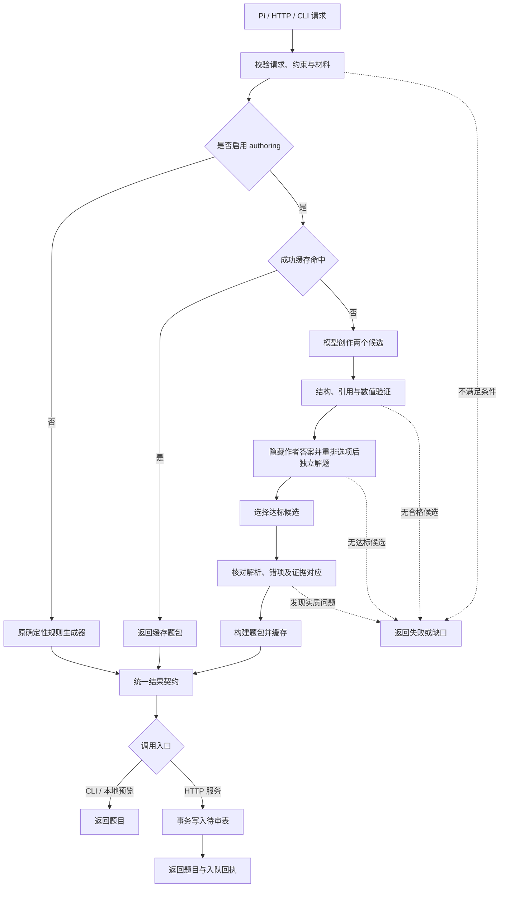

# 自主命题模块设计说明

> **历史快照，不是当前实现。** 团队接手请先看[当前开发进度与接续顺序](question-generalization.md#当前开发进度)和工作区根目录的 `TASK_STATE.md`。下文记录 2026-11-09 的五考点 v1.1 阶段，范围、推理档、测试数量和
> 验证数据均对应当时版本。此后已发生的变化：推理档改为 `high`；新增通用材料驱动路径（24 章节、单选与综合、
> 定向修订，见 [通用命题主线](question-generalization.md)）；模块测试增至 146 项；Pi 的 `author` 操作与
> 600 秒等待配置目前只在未提交的工作树改动中。本文中的"当前"一律指 v1.1 阶段。

版本：材料驱动创作版 v1.1  
日期：2026-11-09  
适用范围：Qodex 教育 Agent 的自主命题模块

本文说明该阶段的设计、选择理由及验证边界。历史运行配置和实验详情见 [五考点实测说明](question-authoring.md)。接口约定见 [自主命题模块说明](question-generation.md)。

## 1. 要解决的问题

原模块已打通“知识库取材 → 生成并自检 → 写入待审表”，具有明确的规则计算、材料定位和稳定接口。但其命题主要依靠固定考法和参数变化：同一个知识点可以生成许多数字不同的题目，却难以主动设计新的推理任务。教材摘要基本不参与题目构思。

本次升级要使模块能够根据教材设计有教学意义的问题，例如根据观察反推条件、诊断错误推理、比较不同方案，而不仅是扩大题目数量。同时保留已有规则生成器的可靠性和低成本，不要求上下游改成新的协作架构。

### 1.1 质量目标

“优秀”首先表现为题目本身，而不是模型规模或处理阶段数量。

| 目标 | 可观察的要求 | 当前验证方式 |
| --- | --- | --- |
| 正确且可答 | 条件充分、答案唯一、解析与题面一致 | 数值复算、答案盲解、解析核对；仍需独立审校 |
| 有实质推理 | 确实需要联立条件、定位错误、迁移或设计 | 根据实际解题过程评价，不按动词或步骤数量直接判定 |
| 有诊断价值 | 错项反映一种可解释的错误机制 | 为每个错项提供解释，并核查它是否真的错误 |
| 有材料依据 | 考查规则和知识结论有来源 | 已核验资料清单、引用规则覆盖及模型语义检查 |
| 可交付、可复验 | 保留学生题面、教师答案、出处及版本 | 统一题包、持久缓存、待审回读、回归测试 |
| 成本适当 | 调用有上限，重试不会无界放大 | 每题最多三次调用，每批最多两道模型题 |

难度是否合适、能否区分学生水平、是否改善学习效果，需要教师与学生数据。当前系统没有把这些指标标记为已验证。

## 2. 职责与范围

| 参与方 | 职责 |
| --- | --- |
| Pi | 发起工具调用、传递约束和材料、展示结果及缺口 |
| 知识库 | 提供可以追溯的材料；命题侧按已核验清单读取 |
| 自主命题 | 设计题目、答案与解析，执行生成侧检查并交付待审题包 |
| 独立审校 | 对具体题目版本作正式审校，决定后续处理 |
| 组卷 | 提供缺题槽位与整卷约束，管理整卷组合 |

本轮新增的是原有五个考点的模型单选题创作：单级分页、栈出栈序列、直接映射 Cache、IPv4 子网网络地址、TCP 消息边界。现有综合题、综合题版本修订和规则单选题继续保留。

**TCP 的模型 `transfer` 目标暂时关闭。** 实测发现题干没有清楚区分“答题者知道的信息”和“接收程序知道的信息”，后续模型审计仍放过该问题。因此在请求入口直接拒绝此组合，而不是依靠更强措辞声称问题已经解决。其他目标可以调用，并不意味着每个“考点 × 目标”组合都已获得同等实测证据。

当前没有通用任意学科出题、模型综合题、模型自然语言修订、自动难度标定或学生自适应出题。以上均指 v1.1 阶段；
通用路径已在此后引入，见文首快照说明。

## 3. 总体架构

采用两条生成路径，共享外部契约。调用方显式选择是否使用模型；系统不自动把失败的模型请求改成规则题，也不把普通规则请求隐式升级为付费调用。



HTTP 服务在缺材料且请求未显式提供 `evidence` 时，可以查询已配置知识库后再生成。显式空数组表示确实没有材料，不触发隐式补充。CLI 和原本地验证台仍以显式材料为主。

## 4. 从教学目标到题目设计

模型创作请求提供一个教学目标，以及可选的具体关注点。目标限制的是学生必须完成的认知任务，不是题干写法。

| 目标 | 设计意图 | 示例 |
| --- | --- | --- |
| `analyze` | 联立条件、反推未知量、比较机制 | 根据两条地址转换观测反推未知页框 |
| `diagnose` | 从具体错误现象定位错误步骤 | 根据两个错误行号判断是否把字节偏移当作 Cache 索引 |
| `transfer` | 把规则用于新的条件或边界情境 | 在明确的新条件下运用原知识规则；TCP 此目标暂不开放 |
| `design` | 选择满足目标的改动或有效测试 | 只改一个页表项同时满足两个访问要求 |

创作输入包含材料摘要、可选原文、科目与考点、显式约束、目标、关注点和种子。模型需要输出题面、四个选项、正确答案、逐项解析、错误机制、教学目标、实际推理步骤和计算记录。

可以增加题目自足的实验条件，例如容量限制、观测结果、待选改动；这些是明确给出的题设假设。需要引用材料支持的则是用于推导的知识规则，不能把未检索到的外部知识当作已获支持。

### 4.1 一次具体的考法变化

旧分页题给出完整页表，要求直接计算物理地址。新题可以给出：

> 页大小为256 B，页0～5的页框恰好为 {0,3,5,7,9,15}，且互不相同。已知页0→5、页2→0、页4→9；虚地址300→物理地址1836，虚地址1000→物理地址4072。求虚地址1400的物理地址。

学生需要从观测反推页1→7、页3→15，利用集合中的剩余页框确定页5→3，再得到物理地址888。这种变化发生在未知量、条件关系和推理顺序上，不仅发生在数字上。

## 5. 模型与程序如何分工

### 5.1 候选创作

第一次模型调用返回两个候选。要求它们具有不同推理结构，而不是只改数字；每题必须说明三个错项背后的错误机制。

这条要求目前主要由提示和后续检查约束，尚无形式化的“考法多样性证明”。本轮实验的六道自动交付题均来自第一候选，双候选没有挽救额外请求，因此不能声称两候选优于单候选。

### 5.2 结构、引用和数值验证

程序检查字段完整性、选项数量和文字唯一性、正确选项标识、解析与错项机制覆盖、引用 ID 是否存在，以及引用子集是否覆盖该考点所需规则。

计算题还必须提交结构化的“数值见证”，即输入参数和声称的计算结果。程序只调用已实现的求解器，不解释或运行模型输出的代码。

| 求解器 | 输入 | 独立计算的结果 |
| --- | --- | --- |
| 分页 | 页大小、虚拟地址、页表 | 虚页号、偏移、页框、物理地址 |
| Cache | 容量、块大小、地址 | 标记、行索引、块内偏移 |
| 栈 | 输入为1～n时的目标输出排列 | 是否可达、首个阻塞位置、最小容量 |
| 子网 | IPv4 地址、前缀长度 | 网络地址、广播地址、可用主机数量 |

显式指定的参数组合、页内偏移和栈元素数量也有对应检查。TCP 概念题不使用上述数值见证。

数值验证的结论限于“这些输入对应这些结果”。它不能单独证明计算记录完整覆盖题目，也不能证明记录与自然语言描述没有错位；后两项仍由语义检查和独立审校承担。

### 5.3 答案盲解

第二次模型调用只接收候选的学生题面、重排后的选项、材料和请求约束，不接收作者答案、解析、推理步骤或数值见证。

盲解输出独立解答及七项质量评价：可答性、材料支持、约束匹配、目标匹配、推理深度、干扰项质量、清晰性。评分为0～2；除干扰项允许至少1分外，其余须为2分，同时没有阻断交付的问题。盲解答案还必须通过选项映射与作者答案一致。

这是一种工程筛选阈值，不是经学生数据标定的教育测量分数。不同调用使用同一个 DeepSeek Flash，具有信息隔离，但仍可能共享知识盲点。

### 5.4 候选选择与解析审计

在达标候选中按质量总分选择一题，同分时取原顺序靠前的候选。第三次模型调用检查作者解析、逐项错因、材料支持以及数值见证与题面对应关系。

审计会收到盲解时的选项版本，避免把重排导致的字母变化误判为答案冲突。审计发现实质问题就返回失败；当前不会转而审计第二候选，也不会自动循环修复。

最终 `self_check.status=PASSED` 表示本轮配置的生成侧检查通过，不表示题目经过正式审校或已获得数学形式化证明。

## 6. 对外接口与数据契约

### 6.1 请求

继续使用 Pi 工具 `question_generation`，参数仍为 `operation` 和 `request`。模型创作可通过 `single`、`batch` 和 `replenishment` 到达同一单题生成入口。

以下为配置了知识库的 HTTP 服务可接收的单题请求：

```json
{
  "schema_version": "0.1",
  "request_id": "paging-analysis-001",
  "subject": "operating_systems",
  "topic": "single_level_paging",
  "question_type": "single_choice",
  "seed": 701,
  "constraints": {
    "page_size": 256,
    "authoring": {
      "objective": "analyze",
      "focus": "根据多条观测反推未知映射"
    }
  }
}
```

发送到 `POST /v1/question-generation/single`。CLI 使用包含显式材料的 [完整示例](../question_generation/examples/authoring.json)。`focus` 可省略，最长500字。

批量在槽位的 `constraints` 中设置同样配置；组卷补题在 `slot_profiles` 对应槽位的 `constraints` 中设置。各槽位仍保留原科目、考点、题型与分值约束。

### 6.2 题目包

| 字段 | 内容与使用者 |
| --- | --- |
| `question_id`、`version` | 题目身份和版本，用于交付及追溯 |
| `metadata` | 科目、考点、题型；批量可附分值 |
| `student_view` | 题干、选项；唯一应直接展示给学生的部分 |
| `instructor_view` | 正确选项、总解析、逐项解析 |
| `evidence_refs` | 实际引用材料的来源、版次和定位 |
| `generator` | 生成器版本、种子、模型名和请求参数 |
| `pedagogy` | 教学目标、推理步骤、错项机制 |
| `self_check` | 检查范围、计算记录、盲解结果、质量评价和审计结论 |
| `review_status` | 保持 `PENDING`，等待独立审校 |

模型结果还包含 `authoring_report`，记录候选选择、拒绝原因和实际调用用量。`evidence_refs` 不保存教材原文，只保存来源定位；题面与解析由模型生成。

`instructor_view`、`pedagogy`、`self_check` 和 `generator` 可能泄露答案或推理，不应与学生视图一起直接展示。

### 6.3 失败与部分成功

| 状态 | 含义 |
| --- | --- |
| `INVALID_REQUEST` | 字段、参数或模型题量预算不合法 |
| `UNSUPPORTED_REQUEST` | 不支持的题型/考点，或关闭的 TCP 模型迁移组合 |
| `NEEDS_MATERIAL` | 缺少支持命题规则的材料 |
| `KNOWLEDGE_BASE_UNAVAILABLE` | 已配置知识库当前不可读取 |
| `MODEL_UNAVAILABLE` | 模型配置、连接、响应格式、截断等问题 |
| `SELF_CHECK_FAILED` | 候选未通过生成侧检查 |
| `AUTHORING_CACHE_UNAVAILABLE` | 缓存路径或数据库不可用 |
| `QUEUE_UNAVAILABLE` / `QUEUE_VERSION_CONFLICT` | 入队不可用，或待审版本冲突 |

失败单题不会作为合格题入队。批量可保留成功题并返回未完成槽位；`PARTIAL`、`NO_QUESTIONS` 等沿用原契约。模型、知识库或缓存不可用的单题 HTTP 响应为503；具体判断以结构化状态为准。

## 7. 材料、缓存与交付可靠性

知识库适配器只读已经核验的资料清单，并检查源文档、片段指纹及冲突标记。本次未增加任意语义检索、自动纳入未核验资料或新的向量数据库。

每次模型创作最多接受16条材料；摘要及可选 `excerpt` 各自有长度限制。知识库片段原文不超过12000字时可直接参与创作；超长分块只保留原摘要，不把截取片段冒充完整原文。请求体还有100 KB的模型调用预算检查。

成功结果保存于 SQLite，键由生成器版本、服务地址、模型名和完整请求共同决定。缓存命中返回原题包，不再次调用模型；未成功的调用不缓存，因此再次请求可能重新付费。维护提示、验证逻辑或生成行为时，需要评估是否升级生成器版本以使旧缓存失效。

外部模型不由本地种子保证逐字确定性。种子用于命题请求和选项重排；清空缓存后重新调用可能产生不同内容和题目 ID。缓存必须放在持久目录。同一个缓存文件在创作期间持有写事务，以防并发重试重复付费；代价是模型创作串行化。

HTTP 服务将实际合格题在事务中写入既有待审表。相同题目与版本重试返回 `ALREADY_QUEUED`，冲突不覆盖已有内容。CLI 与本地验证台仅生成预览，不等同于待审交付。

## 8. 资源控制与方案取舍

| 决策 | 理由与代价 |
| --- | --- |
| 保留规则路径 | 维持基础练习的稳定性与低成本；调用方需明确选择创作模式 |
| 选择模型开放创作 | 让材料参与考法设计；牺牲完全确定性并增加语义错误风险 |
| 使用类型化求解器 | 计算可靠、无需执行模型代码；覆盖范围有限 |
| 同模型分调用盲解 | 接入成本低、隔离作者答案；不能消除模型相关性错误 |
| 有界候选与最多三次调用 | 避免不受控重试；可能因最后一次审计失败而不交付 |
| 每批最多两道模型题 | 适合课程项目的小批量高价值补题；不用于一次生成大题库 |
| 不训练、不引入新Agent框架 | 当前没有充分学生选择数据，维护与部署资源有限 |

v1.1 阶段每次请求使用显式低推理档，输出上限16384 token，响应大小上限1 MB；客户端配置120秒超时并检查响应读取耗时。网络读取的阻塞和服务排队也会影响实际等待时间，不能把它理解为端到端严格实时保证。

Pi 的等待时间独立配置。v1.1 阶段为 15 秒；未提交的工作树改动把默认值改为 600 秒，并可用 `QUESTION_GENERATION_TIMEOUT_MS` 在 1000～1800000 毫秒间调整。取消客户端等待不保证正在执行的服务端工作立即终止，重试应使用原请求以利用缓存。

## 9. 当前验证证据

本次验证分开回答“功能是否正确接入”和“题目是否有所改善”。

| 证据 | 结果与边界 |
| --- | --- |
| 回归测试 | Python 3.9、3.12各84项通过 |
| 旧请求兼容性 | 五考点各100个种子，共500个完整题包及ID与旧版本一致 |
| Pi工具验证 | 3项定向测试通过；使用已验证模型目录的隔离副本全仓检查通过 |
| 交付链路 | Pi→HTTP→知识库→待审表，16份当前题包回读一致；覆盖重试和不可用路径 |
| 十组冻结命题实验 | 20个候选，自动交付6题、拦截4组；没有删除失败样例 |
| 独立复核 | 4道数值题另写程序确认答案，1道TCP设计题经本助手复核可用，1道TCP迁移题存在歧义 |
| 实验资源 | 冻结实验27次调用、194628 token；追加3次核查后共30次、206952 token |

原工作区的 Pi 全仓检查仍受已有模型目录漂移影响；隔离副本的通过结果不等于原工作区全仓检查通过。

交付链路试验复用了真实模型生成与盲解产物，并进行了新的解析审计；链路验证期间禁用外部模型调用，验证的是缓存、接口和数据库行为，不是额外一轮模型生成实验。

本轮提供了实质的新考法样例，也证明生成侧检查可以拦截部分错误。但五道复核可用题是小样本工程证据，不能推导为一般正确率、学习效果提升率或稳定的难度等级。已知漏检导致关闭对应入口，是当前设计边界的一部分。

## 10. 实现位置

| 文件 | 职责 |
| --- | --- |
| [generation.py](../question_generation/generation.py) | 共用单题入口、原规则路径及创作路由 |
| [authoring.py](../question_generation/authoring.py) | 创作契约、候选检查、盲解与审计编排、成功缓存 |
| [model_client.py](../question_generation/model_client.py) | 有界 JSON 模型调用、错误处理和用量记录 |
| [verification.py](../question_generation/verification.py) | 类型化数值见证求解与核验 |
| [knowledge.py](../question_generation/knowledge.py) | 已核验材料读取、原文及来源定位 |
| [batch.py](../question_generation/batch.py)、[replenishment.py](../question_generation/replenishment.py) | 槽位分配、模型题量限制、去重和组卷缺口适配 |
| [service.py](../question_generation/service.py) | HTTP 服务、知识库衔接和待审事务 |
| [Pi 命题扩展](../pi-coding-agent/packages/coding-agent/src/extensions/question-generation/index.ts) | 原工具协议、创作调用指引和等待配置 |
| [创作回归测试](../tests/test_question_generation_authoring.py) | 结构错误、计算错误、盲解分歧、缓存、预算及关闭模式的验证 |

## 11. 后续方向与验收条件（未实现）

| 方向 | 开始或开放前应取得的证据 |
| --- | --- |
| 单候选与双候选比较 | 在新样本上比较实际可用率、调用耗时和用量；当前双候选没有已证实收益 |
| 恢复TCP迁移题 | 明确建模题中不同主体的信息范围，在新歧义反例和正常题上验证，不能只让原反例通过 |
| 拓展考点及综合题 | 补齐材料契约、求解或验证方式、评分结构和接口回归 |
| 教师与学生评价 | 教师盲评、学生错项选择和作答数据，再讨论难度、区分度及学习成效 |
| 更高并发部署 | 用独立任务执行和请求去重替代长 SQLite 写事务，并验证取消与恢复行为 |

这些方向不是本轮已交付能力，也不是必须同时建设的后续架构。

## 12. 研究依据

设计借鉴了 [ACL 2025 的误解导向干扰项生成](https://aclanthology.org/2025.acl-long.1154/)、[BEA 2024 的候选生成与排序](https://aclanthology.org/2024.bea-1.19/)、[AIED 2024 的教育命题评价实现](https://github.com/nicyscaria/AEQG_Blooms_Evaluation_LLMs)，以及 [PrairieLearn 的模型辅助命题](https://docs.prairielearn.com/question/ai-generation/)和[可执行测试接口](https://docs.prairielearn.com/question/server/)。采用这些方法的动机不代表它们已在本项目复现论文效果。

模型接口依据为本轮已核对的 [DeepSeek JSON 输出](https://api-docs.deepseek.com/guides/json_mode/)和[思考模式](https://api-docs.deepseek.com/guides/thinking_mode/)文档。当前配置使用 `deepseek-flash`；模型及价格会更新，后续部署需重新核对。
