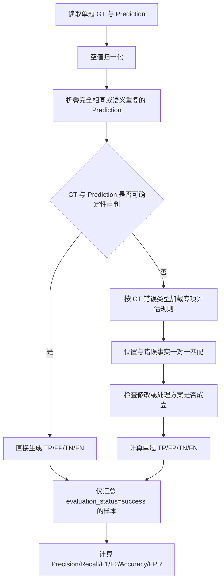

# AI 审校评估体系与混淆矩阵计数规范

## 1. 文档目的

本文档定义 Qodex 项目中 AI 审校模块的统一评估方式，供数据标注、模型评测、Prompt 迭代、结果验收和组内沟通使用。

本规范参考既有试题审校项目的评估逻辑，核心特点是：

- 以 Ground Truth（以下简称 **GT**）中的真实错误为参照；
- 将模型输出的每条错误报告视为一条 Prediction；
- 先按错误位置和错误事实做一对一语义匹配，再判断修改方案是否成立；
- 使用 `TP / FP / TN / FN` 记录结果；
- 重复报告先折叠，不参与计分；
- 对同一次完全失败采用“禁止双罚”规则：Prediction 非空但没有任何有效 TP 时，只计 FP，不再同时追加 FN。

本文档描述的是**审校结果质量评估**，不是路由分类器的多标签评估。路由器可以另行统计每类任务的 Recall、Precision 和兜底率，但最终审校结果仍按本文档计分。

## 2. 适用范围

当前适用于以下九类试题错误：

1. 错别字；
2. 标点符号错误；
3. 选项结构错误；
4. 信息缺失；
5. 题目与题型不一致；
6. 答案泄露；
7. 语义不清；
8. 题目无解；
9. 事实/逻辑错误。

图文不一致、多语种审校等类型如后续加入，也应复用本文的通用匹配和计数规则，再补充各自的专项边界。

## 3. 基本概念

### 3.1 GT

GT 是人工确认的真实错误集合。每个独立错误至少应包含：

- 错误类型；
- 可定位的错误位置或错误对象；
- 错误事实说明；
- 一个参考修改方案。

GT 的修改方案是**参考答案之一**，不是要求模型逐字复现的唯一答案。

### 3.2 Prediction

Prediction 是模型输出的一条具体错误报告。通常包含：

- 错误类型；
- 原文位置或锚点；
- 错误描述；
- 修改或处理建议。

同一道题可以有零条、一条或多条 Prediction。

### 3.3 独立错误项

能够分别被发现和修复的错误应标注为不同 GT。例如一句话中有两个互不相关的错别字，应计为两个 GT；同一根因引起的多个表面症状通常只计一个 GT。

### 3.4 评估单元

默认评估单元是“一道题及其完整上下文”，包括题干、选项、答案、解析、题型信息和必要的共用材料。

同一道题内：

- GT 可以有多项；
- Prediction 可以有多项；
- 每条 Prediction 最多匹配一个 GT；
- 每个 GT 最多被一条 Prediction 匹配。

## 4. 总体评估流程



具体顺序必须保持为：

1. 空值归一化；
2. 重复 Prediction 折叠；
3. 确定性预检；
4. 一对一语义匹配；
5. 修改有效性判断；
6. 混淆矩阵计数；
7. 汇总指标。

## 5. 空值归一化

以下值及语义等价形式均视为空，不构成实际错误项：

```text
空字符串
[]
['nan']
["nan"]
nan
None
null
"无"
```

空值必须在匹配和计数之前统一处理，不能把 `nan`、`None` 等占位符当成一条 Prediction。

## 6. 匹配原则

### 6.1 先看位置，再看修改

一条 Prediction 记为 TP，必须同时满足：

1. **位置或错误事实命中**：明确指向与 GT 相同的文本位置、对象、结构缺口、冲突点、泄露点或阻断点；
2. **修改或处理方案成立**：在完整题面中合理、自然、自洽，符合题型核心要求，并且没有引入明确的新错误。

### 6.2 不要求复现 GT 的原话

以下差异本身不能导致 FP：

- 修改后的字词与 GT 不同，但同样正确；
- 使用的专业术语与 GT 不同，但指向同一错误事实；
- 截取的文本范围不同，但明显重叠并指向同一位置；
- 错误类型标签不同，但语义相近且错误事实一致；
- 采用了不同但合理的修复路径。

例如，GT 给出一种修法，而模型给出另一种同样成立的修法，应计 TP。

### 6.3 一对一匹配

- 一条 Prediction 不能同时贡献多个 TP；
- 一个 GT 不能被多条 Prediction 重复贡献 TP；
- 一条 Prediction 不能同时记 TP 和 FP；
- 已被有效命中的 GT 不能再记 FN。

### 6.4 重复报告折叠

若多条 Prediction 指向同一位置、同一错误事实或同一根因，只保留其中一条参与匹配，其余标记为 `DUP` 或内部重复项并忽略：

```text
DUP 不计 TP
DUP 不计 FP
DUP 不计 TN
DUP 不计 FN
```

`DUP` 是匹配过程中的辅助状态，不是混淆矩阵的第五个类别。

## 7. TP、FP、TN、FN 定义

| 类型 | 定义 | 计数单位 |
| --- | --- | --- |
| TP | Prediction 命中某个尚未匹配的 GT，且修改或处理方案成立 | 每个成功匹配的独立 GT 计 1 |
| FP | Prediction 报告了不存在的错误；或位置命中但修改不成立、未解决问题、破坏题意或引入新错误 | 每条非重复的无效 Prediction 计 1 |
| TN | GT 与 Prediction 均实质为空 | 每道无错且未报错的题计 1 |
| FN | GT 非空但 Prediction 为空；或已有有效 TP 后，仍有其他独立 GT 完全未被定位 | 每个符合条件的未命中 GT 计 1 |

### 7.1 关键非标准规则：禁止同一次失败双罚

本体系沿用参考项目的特殊口径：

> 当 Prediction 非空，但所有 Prediction 都无效、整题没有任何 TP 时，只用 FP 表示本次失败，不再为相同失败追加 FN。

因此：

```text
GT 非空 + Prediction 非空 + TP=0
=> 统计 FP
=> FN 固定为 0
```

这与部分传统目标检测评估中“错误预测计 FP，同时未命中的 GT 再计 FN”的方式不同。团队比较外部论文或第三方系统时，必须注明本项目采用了“不双罚”口径。

## 8. 完整决策表

设 GT 中有 `m` 个独立错误，Prediction 经重复折叠后有 `n` 条实际错误报告。

| 场景 | TP | FP | TN | FN | 说明 |
| --- | ---: | ---: | ---: | ---: | --- |
| GT 为空，Prediction 为空 | 0 | 0 | 1 | 0 | 正确判断无错 |
| GT 为空，Prediction 有 `n` 条 | 0 | `n` | 0 | 0 | 所有报告均为误报 |
| GT 有 `m` 项，Prediction 为空 | 0 | 0 | 0 | `m` | 每个 GT 均漏报 |
| 1 个 GT，位置命中且修改合理 | 1 | 0 | 0 | 0 | 标准 TP |
| 1 个 GT，位置命中，修法与 GT 不同但同样合理 | 1 | 0 | 0 | 0 | GT 不是唯一答案 |
| 1 个 GT，位置命中但修改错误 | 0 | 1 | 0 | 0 | 只计 FP，不追加 FN |
| 1 个 GT，Prediction 指向无关位置 | 0 | 1 | 0 | 0 | 只计 FP，不追加 FN |
| `m` 个 GT，所有 Prediction 均无效 | 0 | 无效 Prediction 数 | 0 | 0 | 没有 TP，禁止双罚 |
| `m` 个 GT，正确命中 `k` 项，无其他报告 | `k` | 0 | 0 | `m-k` | `0 < k < m` |
| `m` 个 GT，命中 `k` 项，另有 `r` 条误报 | `k` | `r` | 0 | `m-k` | 已有 TP，可同时出现 FP 和 FN |
| 多条 Prediction 重复报告同一个 GT | 1 | 0 | 0 | 其余未命中 GT 数 | 首条有效匹配，其余 DUP 忽略 |

只要 GT 或 Prediction 任一方存在实际错误项，`TN` 必须为 0。

## 9. 典型案例

### 9.1 双方均无错误

```text
GT：无错误
Prediction：[]
```

结果：

```json
{"TP": 0, "FP": 0, "TN": 1, "FN": 0}
```

### 9.2 无错题发生误报

```text
GT：无错误
Prediction：报告 2 个不存在的问题
```

结果：

```json
{"TP": 0, "FP": 2, "TN": 0, "FN": 0}
```

### 9.3 有错题完全未报告

```text
GT：2 个独立错误
Prediction：[]
```

结果：

```json
{"TP": 0, "FP": 0, "TN": 0, "FN": 2}
```

### 9.4 找对位置且修改正确

```text
GT：“再接再励”中的“励”应改为“厉”
Prediction：将“再接再励”改为“再接再厉”
```

结果：

```json
{"TP": 1, "FP": 0, "TN": 0, "FN": 0}
```

### 9.5 找对位置但修改错误

```text
GT：“再接再励”中的“励”应改为“厉”
Prediction：将“再接再励”改为“再接再力”
```

结果：

```json
{"TP": 0, "FP": 1, "TN": 0, "FN": 0}
```

解释：Prediction 定位了相关位置，但修复结果错误，因此计 FP；依据“不双罚”规则，不再为同一个 GT 追加 FN。

### 9.6 修法不同但同样成立

```text
GT：建议补充缺失内容 A
Prediction：使用结构性占位符“[缺失条件]”，且当前题面无法唯一还原 A
```

结果：

```json
{"TP": 1, "FP": 0, "TN": 0, "FN": 0}
```

解释：模型准确指出同一结构缺口，且无法唯一还原时使用明确占位符属于合理处理，不要求复制 GT 原文。

### 9.7 部分命中多个 GT

```text
GT：2 个独立错误
Prediction：正确命中其中 1 个，另一个未报告
```

结果：

```json
{"TP": 1, "FP": 0, "TN": 0, "FN": 1}
```

“只命中部分 GT”本身不是 FP。已经正确命中的部分照常记 TP，剩余完全未定位的独立 GT 记 FN。

### 9.8 部分命中，同时存在误报

```text
GT：3 个独立错误
Prediction：正确命中 1 个，误报 1 个，其余 2 个未报告
```

结果：

```json
{"TP": 1, "FP": 1, "TN": 0, "FN": 2}
```

已有 TP 后，可以同时出现 FP 和 FN。

### 9.9 多 GT，但唯一 Prediction 修改错误

```text
GT：2 个独立错误
Prediction：报告其中一个位置，但修改方案明显错误
```

结果：

```json
{"TP": 0, "FP": 1, "TN": 0, "FN": 0}
```

解释：整题没有有效 TP，Prediction 又非空，因此只计 FP，不追加两个 FN。

### 9.10 重复报告

```text
GT：1 个错别字
Prediction 1：准确指出该错别字并正确修改
Prediction 2：换一种说法再次报告同一个错别字
```

匹配结果：

```text
Prediction 1 = TP
Prediction 2 = DUP（忽略）
```

最终计数：

```json
{"TP": 1, "FP": 0, "TN": 0, "FN": 0}
```

### 9.11 类型标签不同但错误事实相同

```text
GT 类型：错别字
Prediction 类型：拼写错误
GT 与 Prediction 指向同一个字，且修改成立
```

结果：

```json
{"TP": 1, "FP": 0, "TN": 0, "FN": 0}
```

错误类型名称不是唯一判断依据，错误事实一致时允许语义近似标签匹配。

### 9.12 顶层类型明确不兼容

当 GT 和 Prediction 均使用系统已知的顶层类型，且二者明确不兼容时，可以在语义 Judge 前确定性直判。例如 GT 为“错别字”，Prediction 唯一明确类型为“题目无解”，且没有可匹配的错误事实：

```json
{"TP": 0, "FP": 1, "TN": 0, "FN": 0}
```

如果 Prediction 使用的是细分现象、流程标签、未知标签或包含多个不同类型，则不应仅凭类型名称直判，应交给语义 Judge 检查错误事实。

## 10. “部分命中”的判定细则

“部分命中”需要区分三种情况：

### 10.1 命中部分 GT 项

多个独立 GT 中只正确命中一部分：已命中的计 TP，未定位的独立 GT 计 FN。

### 10.2 命中位置，但修复没有真正解决问题

若模型只改了一部分，导致原问题仍然存在，或引入新问题，则该 Prediction 计 FP；若整题没有其他 TP，则不追加 FN。

### 10.3 一个 GT 实际包含多个可独立修复的问题

这属于 GT 标注粒度问题。应先将 GT 拆分为多个独立错误项，再评估 Prediction，不应让 Judge 临时猜测一个 GT 到底包含几项错误。

## 11. 确定性预检与语义 Judge 的分工

### 11.1 可以直接判定的情况

以下情况不需要语义模型：

- GT 空、Prediction 空：`TN=1`；
- GT 非空、Prediction 空：按 GT 数量计 FN；
- GT 空、Prediction 非空：按 Prediction 数量计 FP；
- GT 与 Prediction 均有错误，且唯一明确的顶层错误类型互不兼容：按 Prediction 数量计 FP，不追加 FN。

### 11.2 必须进入语义 Judge 的情况

- GT 与 Prediction 类型兼容；
- 类型名称缺失；
- Prediction 含多个不同类型；
- Prediction 使用细分类或现象描述；
- 需要判断位置是否重叠；
- 需要判断修改方案是否成立；
- 需要识别语义重复项；
- 同一题有多个 GT 或多个 Prediction，需要一对一匹配。

### 11.3 Judge 输出契约

Judge 只返回可解析 JSON：

```json
{
  "TP": 1,
  "FP": 0,
  "TN": 0,
  "FN": 1,
  "reason": "命中第一处错字，第二处独立错字未报告"
}
```

约束：

- 四个计数字段必须是非负整数；
- `TN` 只能为 0 或 1；
- `TN=1` 时，TP、FP、FN 必须全部为 0；
- `TP=0、FP>0` 时，FN 必须为 0；
- `reason` 必须简短说明匹配、误报或漏报事实；
- 格式错误可以有限重试，仍失败则该样本不得进入指标汇总。

## 12. 评估状态与异常样本

每个评估单元除混淆矩阵外，还必须保存 `evaluation_status`。

建议状态包括：

| 状态 | 含义 | 是否进入指标 |
| --- | --- | --- |
| `success` | 评估成功，四项计数均有效 | 是 |
| `configuration_error` | 规则、Prompt 或 Judge 未配置 | 否 |
| `llm_call_failed` | Judge 调用失败 | 否 |
| `parse_fail` | Judge 输出无法解析 | 否 |
| `skipped_timeout` | 上游检测超时，无法公平评估 | 否 |
| `skipped_parse_failed` | 上游检测结果解析失败 | 否 |
| `processing_exception` | 评估程序异常 | 否 |

路由器主动判断“无需执行某类审校”不应被当成技术跳过。它等价于该类 Prediction 为空：

- 对负样本应计 TN；
- 对正样本应计 FN。

否则路由漏检会被排除在指标外，导致 Recall 虚高。

## 13. 汇总指标

只对 `evaluation_status=success` 且 TP、FP、TN、FN 均有效的样本求和：

```text
Precision = TP / (TP + FP)
Recall    = TP / (TP + FN)
F1        = 2 × Precision × Recall / (Precision + Recall)
F2        = 5 × Precision × Recall / (4 × Precision + Recall)
Accuracy  = (TP + TN) / (TP + TN + FP + FN)
FPR       = FP / (FP + TN)
```

分母为 0 时，对应指标按 0 处理，并同时展示原始计数，避免只看比例产生误解。

### 13.1 不要混用两种“误报率”

以下两个值含义不同：

```text
1 - Precision = FP / (TP + FP)
FPR           = FP / (FP + TN)
```

- `1 - Precision` 表示“模型报出的错误中，有多少是错报”；
- `FPR` 表示“实际负例中，有多少被错误报出”。

文档和看板应直接写公式或使用明确名称，不建议仅写含义不清的 `FRR`。

### 13.2 Accuracy 的解释限制

本体系中 TP、FP、FN 可以按错误项累计，而 TN 按整道无错题累计，因此 Accuracy 混合了“错误项级”和“题目级”计数。它可以作为辅助指标，但模型迭代应优先关注：

- Precision；
- Recall；
- F1/F2；
- 各错误类型分项结果；
- 失败、跳过和无效样本数量。

## 14. 结果报告要求

每次完整评测至少保存：

- 模型名称和精确版本；
- Prompt Profile 版本及哈希；
- 数据集版本及哈希；
- Judge 模型和评估规则版本；
- 解码参数、并发数和运行时间；
- 每道题的 GT、原始 Prediction、去重后 Prediction；
- 每道题的 TP、FP、TN、FN、reason、evaluation_status；
- 每类错误的混淆矩阵和指标；
- 全量汇总指标；
- 超时、失败、跳过和无效样本清单。

推荐汇总表：

| 错误类型 | TP | TN | FP | FN | Precision | Recall | F1 | F2 | FPR | 成功样本 | 无效/跳过样本 |
| --- | ---: | ---: | ---: | ---: | ---: | ---: | ---: | ---: | ---: | ---: | ---: |
| 错别字 |  |  |  |  |  |  |  |  |  |  |  |
| 标点符号错误 |  |  |  |  |  |  |  |  |  |  |  |
| 选项结构错误 |  |  |  |  |  |  |  |  |  |  |  |
| 信息缺失 |  |  |  |  |  |  |  |  |  |  |  |
| 题目与题型不一致 |  |  |  |  |  |  |  |  |  |  |  |
| 答案泄露 |  |  |  |  |  |  |  |  |  |  |  |
| 语义不清 |  |  |  |  |  |  |  |  |  |  |  |
| 题目无解 |  |  |  |  |  |  |  |  |  |  |  |
| 事实/逻辑错误 |  |  |  |  |  |  |  |  |  |  |  |

## 15. 标注与复核要求

### 15.1 GT 原子化

- 一个 GT 只描述一个可独立定位、独立修复的错误；
- 同一根因的症状不要重复标注；
- 多个独立错误不要合并成一段模糊 correction；
- `error_cnt` 必须与独立 GT 数量一致。

### 15.2 正负样本

- 每类错误都应包含足够的有错正样本和无错负样本；
- 负样本应覆盖容易误报的题型边界；
- 同一原题的变体不能跨训练集和测试集，防止泄漏。

### 15.3 人工复核

以下样本应进入人工复核队列：

- Judge 低置信或理由含糊；
- 修改方案存在多个专业上可接受的答案；
- GT 自身疑似错误或不完整；
- 错误类型边界存在争议；
- 同一根因和多个独立错误难以区分；
- 模型指出了 GT 未标注但客观存在的新错误。

若确认模型发现了 GT 漏标错误，应先修订数据集版本，再重新评测，不能直接把客观正确的 Prediction 当作 FP。

## 16. 实现伪代码

```python
def evaluate_one_question(gt_items, prediction_items):
    gt_items = normalize_and_atomize(gt_items)
    prediction_items = normalize_empty_values(prediction_items)
    prediction_items = collapse_semantic_duplicates(prediction_items)

    if not gt_items and not prediction_items:
        return {"TP": 0, "FP": 0, "TN": 1, "FN": 0}

    if gt_items and not prediction_items:
        return {"TP": 0, "FP": 0, "TN": 0, "FN": len(gt_items)}

    if not gt_items and prediction_items:
        return {"TP": 0, "FP": len(prediction_items), "TN": 0, "FN": 0}

    matches = one_to_one_semantic_match(gt_items, prediction_items)
    tp = count_valid_matches(matches)
    fp = count_unmatched_or_invalid_predictions(matches)

    # 参考项目的“不双罚”口径
    if tp == 0 and fp > 0:
        fn = 0
    else:
        fn = count_completely_unlocated_gt(matches)

    return {"TP": tp, "FP": fp, "TN": 0, "FN": fn}
```

## 17. Qodex 落地检查清单

- [ ] GT 已拆成独立错误项并记录 `error_cnt`；
- [ ] 空值占位已经统一归一化；
- [ ] 完全相同和语义重复 Prediction 已折叠；
- [ ] 匹配按“位置/错误事实优先，修改有效性其次”执行；
- [ ] 合理但不同于 GT 的修法不会被误判为 FP；
- [ ] 修改错误时计 FP，并遵守“不双罚”规则；
- [ ] 路由跳过按空 Prediction 进入 TN/FN 评估；
- [ ] 失败、超时和解析异常不会伪装成 0 分结果；
- [ ] 只有 `evaluation_status=success` 的有效计数进入汇总；
- [ ] 看板明确区分 `1-Precision` 和 `FPR`；
- [ ] 每次评测保存模型、Prompt、数据和 Judge 版本；
- [ ] 报告同时展示原始计数、比例和无效样本数。

## 18. 版本约定

建议为评估规则单独维护版本号，例如：

```text
evaluation_protocol_version = "1.0.0"
```

以下修改必须升级评估协议版本，并重新计算历史基线：

- 修改 TP/FP/FN 的计数规则；
- 改变“不双罚”规则；
- 改变重复 Prediction 的处理方式；
- 改变 GT 原子化粒度；
- 修改支持的错误类型或类型兼容映射；
- 更换 Judge 或专项评估 Prompt；
- 修改哪些 evaluation_status 可以进入汇总。

不同评估协议版本的指标不能直接横向比较。
